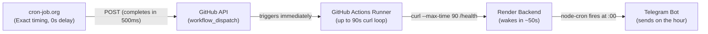

# Scheduling

Murmur runs scheduled background cron processes using **node-cron** within the persistent backend environment ([`apps/api`](../apps/api), [`cronService.ts`](../apps/api/src/services/cronService.ts)).

---

## Job Schedules

The background worker schedules several recurring jobs pinned to **Asia/Kolkata (IST)**:

| Job Name | Trigger Frequency | Scope / Logic | Status |
|----------|-------------------|---------------|--------|
| `daily_morning` | Hourly (00 min) + Startup | Queries users whose preferred `morningHour` (default 8 AM IST) matches the current IST hour and generates a daily action task. Idempotent via `job_runs`. | **Active** |
| `daily_evening` | Hourly (00 min) + Startup | Queries users with `eveningNotificationEnabled: true` whose preferred `eveningHour` (default 8 PM IST) matches the current IST hour. Idempotent via `job_runs`. | **Active (Opt-in)** |
| `weekly_planner` | Hourly (00 min) + Startup | Runs at 6:00 PM IST on user's chosen day (default Sunday) and generates weekly summary + upcoming plan. Idempotent via `job_runs`. | **Active** |
| `memory_summarize` | Nightly at 2:00 AM IST + Startup | Aggregates user logs and generates the updated conversation rolling summary. | **Active** |
| `embedding_backfill` | Nightly at 3:00 AM IST + Startup | Runs vector calculations on any unprocessed database messages. | **Active** |

---

## Render Free Tier & The Hybrid Trigger Architecture

Murmur's backend runs on **Render** (Free Tier Web Service), which spins down after 15 minutes of inactivity to save compute.

### Why Direct Cron Fails:
1. **Direct cron-job.org to Render:** Fails because cron-job.org has a 10–15s client timeout, whereas Render takes ~50–60s to cold-boot.
2. **Native GitHub Actions Cron (`schedule`):** Fails because GitHub's free-tier scheduled queue is routinely delayed by 5–8 hours.

### The Solution: cron-job.org + GitHub Actions `workflow_dispatch`

We combine the precision of cron-job.org with the long-running execution power of GitHub Actions:



1. **cron-job.org** sends a lightweight `POST` request to the GitHub REST API at the exact minute (e.g. 10:50 AM IST and 07:50 PM IST).
2. The GitHub API responds in **< 1 second** (`204 No Content`), well within cron-job.org's timeout limit.
3. GitHub Actions immediately starts [`wake-render.yml`](../.github/workflows/wake-render.yml) via the on-demand API queue (bypassing the slow cron queue).
4. The GitHub runner runs a 90-second curl loop, patiently waiting for Render's container to cold boot (~50s).
5. Render wakes up and is fully warm. At the top of the hour (e.g. 11:00 AM / 8:00 PM), `node-cron` fires and dispatches notifications to Telegram right on time.
6. Render goes back to sleep 15 minutes later, consuming only ~15–20 hours of Render compute per month.

---

## Setup Guide: cron-job.org Integration

### 1. Create a GitHub Personal Access Token (PAT)
1. Go to GitHub **Settings** → **Developer Settings** → **Personal Access Tokens** → **Fine-grained tokens** (or Tokens Classic).
2. Generate a new token with:
   - **Repository access:** `knishkarora/Murmur`
   - **Permissions:** **Actions** (Read and Write).
3. Copy the token.

### 2. Configure Jobs in cron-job.org
Create jobs for your pre-warm schedule (10 minutes before delivery hours):

| Schedule (IST) | Target Delivery | Purpose |
| :--- | :--- | :--- |
| **10:50 AM daily** | 11:00 AM IST | Morning Action pre-warm |
| **07:50 PM daily** | 08:00 PM IST | Evening Reflection pre-warm |
| **05:50 PM Sundays** | 06:00 PM IST | Weekly Planner pre-warm |

For each job in cron-job.org:
* **URL:** `https://api.github.com/repos/knishkarora/Murmur/actions/workflows/wake-render.yml/dispatches`
* **Request Method:** `POST`
* **Request Headers:**
  * `Authorization`: `Bearer YOUR_GITHUB_PAT`
  * `Accept`: `application/vnd.github+json`
  * `User-Agent`: `cron-job-org`
  * `Content-Type`: `application/json`
* **Request Body:**
  ```json
  {"ref": "main"}
  ```

---

## Idempotency & Fail-Safe Mechanics

To prevent duplicate alerts if the backend restarts or is pinged multiple times, we use the database `job_runs` table as an idempotency lock:
* Before dispatching, the scheduler attempts an `INSERT INTO job_runs (job_type, user_id, run_date)`.
* A unique index on `(job_type, user_id, run_date)` guarantees that each user receives at most one notification per job type per day.

---

## Related Docs
- [[Database]]
- [[Telegram Integration]]
- [[AI and Memory]]
